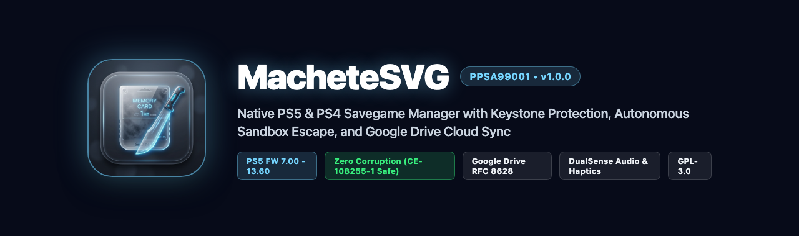
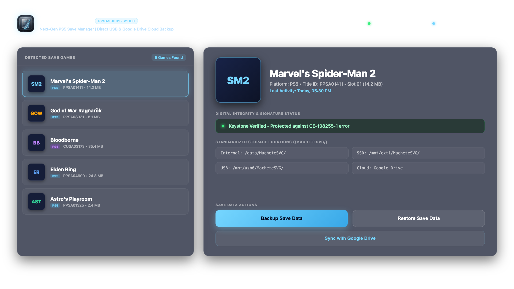
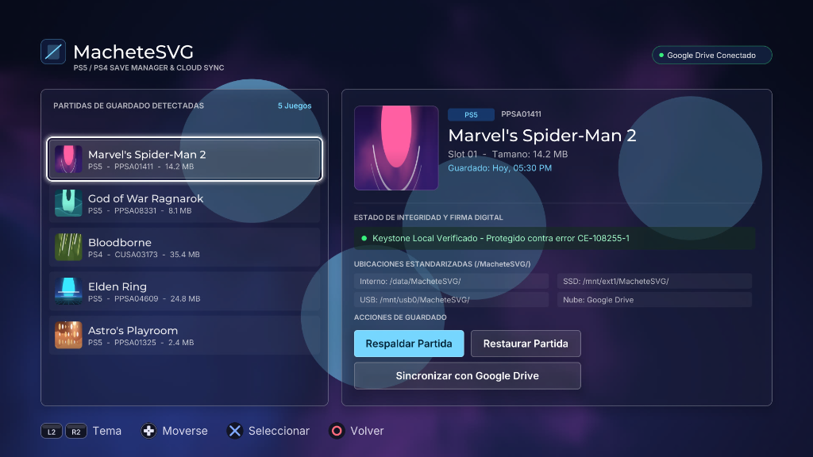
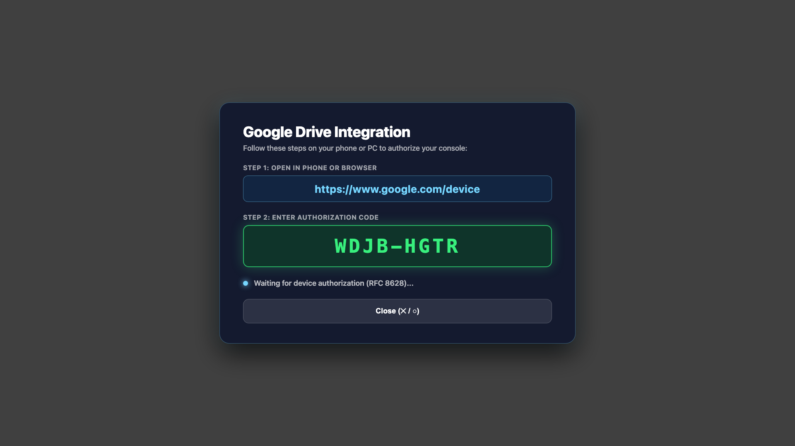
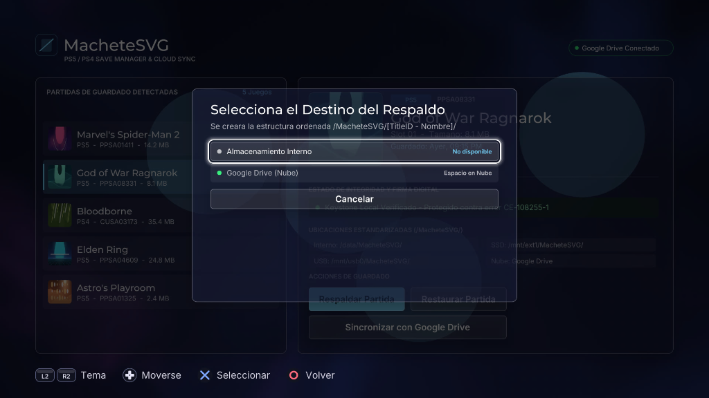

# MacheteSVG (PS5 & PS4 Savegame Manager & Cloud Sync)



[](https://github.com/VenezuelanBiggie24/MacheteSVG-PS5-Save-Manager)
[](https://github.com/VenezuelanBiggie24/MacheteSVG-PS5-Save-Manager)
[](https://github.com/VenezuelanBiggie24/MacheteSVG-PS5-Save-Manager)
[](LICENSE)
[](https://github.com/VenezuelanBiggie24/MacheteSVG-PS5-Save-Manager/releases/tag/v1.0.0)

**MacheteSVG** is a native PlayStation 5 homebrew application designed to back up and restore save data (*savegames*) for both PS5 native titles and PS4 backwards-compatible games with **100% reliability**, zero risk of data corruption (preventing error `CE-108255-1`), and seamless cloud synchronization via **Google Drive**.

---

## English Documentation

### Interface Showcase & Screenshots

The user interface is powered by a custom hardware-accelerated OpenGL 4.6 SDF renderer that delivers a fluid 60 FPS "Liquid Glass" translucent design with dual-panel layout, real-time box art rendering, spring kinematics, and full DualSense controller audio and haptic support.

| English Dashboard (1080p Render) | PS5 Hardware Capture (Real Console) |
| :---: | :---: |
|  |  |

| Google Drive RFC 8628 Device Flow | Modal Location Selector (Real Console) |
| :---: | :---: |
|  |  |

---

### Core Architecture & Capabilities

#### 1. Zero-Corruption Save Architecture (Keystone Protection)
- **Keystone Cryptographic Preservation:** During save restore operations, console-specific identity files (`sce_sys/keystone` and `sce_sys/param.sfo`) are strictly preserved and never overwritten. Only the underlying save payload container (`data000.bin`) is replaced. This architecture enables effortless cross-user auto-resigning of saves downloaded from external consoles or community repositories.
- **CE-108255-1 Prevention:** Unmounts save containers via clean `sceSaveDataUmount` system calls, allowing the Prospero kernel to seal and encrypt the PFS container without filesystem corruption.
- **Global vnode Flush (`sync()` / `fsync()`):** Atomic write operations followed by FreeBSD vnode cache invalidation guarantee that PS4 backwards-compatibility emulator caches reload restored save data instantly without requiring console reboots or game restarts.
- **Dummy Save Safeguard:** If attempting to restore a save for a title that has never been booted on the console, MacheteSVG prompts the user to launch the game once so that authentic local cryptographic keys are generated by the system.

#### 2. Google Drive Cloud Synchronization
- **OAuth 2.0 Device Authorization Grant (RFC 8628):** Securely pairs the console with your Google Drive account without inputting sensitive passwords on-screen. Simply open `https://www.google.com/device` on any phone or browser and type the temporary code displayed (e.g., `WDJB-HGTR`).
- **Token Persistence:** Stores OAuth refresh tokens in `/data/MacheteSVG/google_auth.json` for automatic non-interactive renewal.
- **Asynchronous Worker Threads:** Cloud upload and download jobs run entirely within background threads (`std::thread`), maintaining a locked 60 FPS user interface without stutter or hitching.
- **Dedicated Quick Action:** Instant cloud drawer access via the top-right header chip or direct controller shortcut (**Triangle**).

#### 3. Autonomous Sandbox Escape & Community Title ID Standard
- **Title ID `PPSA99001`:** Conforms to the community-established homebrew Title ID convention (`PPSA99xxx`, adopted by projects such as ProsperoStore `PPSA99000`) to guarantee zero conflicts with retail PlayStation Store software.
- **Embedded Lapy Daemon:** Packages `lapy_jb_daemon.elf` directly within the application package (`/app0/lapy_jb/`).
- **Local ELF Loader Auto-Launch:** Connects autonomously to `127.0.0.1:9021` to trigger root privilege escalation (`ucred` credential elevation) through `/download0/etahen_jailbreak`. No manual third-party payload senders are needed.
- **Live Jailbreak Monitor:** Dynamic status indicator displaying root authorization status with automatic background retry logic.

#### 4. Internationalization (i18n) Engine
- **English Default:** All system prompts, error codes, and fallback dialogs default to English.
- **Automatic Language Detection:** Inspects console parameters through `sceSystemServiceParamGetInt`. Spanish systems automatically start in Spanish, while English and all other languages (Japanese, French, German, Italian, etc.) default to English.
- **Real-Time Language Switch:** Press **L3** (Left Stick Click) at any moment to switch instantly between English and Spanish.
- **Zero Runtime Allocations:** Centralized `machete::i18n::tr()` lookup tables ensure zero dynamic memory allocation during language switching.

#### 5. Storage Hierarchy
Backups follow an organized, sanitized filesystem layout across all supported media:
- **Internal Storage:** `/data/MacheteSVG/[TitleID - Game Name]/`
- **M.2 Expansion SSD:** `/mnt/ext1/MacheteSVG/[TitleID - Game Name]/`
- **External USB Media:** `/mnt/usb0/MacheteSVG/[TitleID - Game Name]/`
- **Google Drive:** `/MacheteSVG/[TitleID - Game Name]/`

---

### Controller Navigation (DualSense)

| Button | Action |
| :--- | :--- |
| **D-Pad Up / Down** | Navigate through installed game saves |
| **Cross (X)** | Confirm selection / Open backup destination picker |
| **Square** | Open restore source picker |
| **Triangle** | Open Google Drive cloud synchronization |
| **L3 (Stick Click)** | Instant language toggle (English / Spanish) |
| **Circle** | Cancel active dialog / Return to dashboard |

---

## Documentación en Español (Spanish Documentation)

### Galería de Capturas de Pantalla

La interfaz gráfica cuenta con un renderizador SDF sobre OpenGL 4.6 acelerado por hardware que funciona a 60 FPS fluidos con diseño translúcido "Liquid Glass", vista dividida, carátulas en tiempo real, física de resortes y respuesta sonora completa de DualSense.

| Panel Principal en Inglés (Render 1080p) | Captura de Hardware Real en PS5 |
| :---: | :---: |
|  |  |

| Autorización Google Drive RFC 8628 | Selector Modal de Ubicación (Consola Real) |
| :---: | :---: |
|  |  |

---

### Arquitectura y Capacidades Principales

#### 1. Arquitectura con Cero Corrupción (Protección de Keystone)
- **Preservación Criptográfica de Keystone:** Durante las operaciones de restauración, los archivos de identidad de la consola (`sce_sys/keystone` y `sce_sys/param.sfo`) se mantienen intactos y nunca se sobrescriben. Solo se actualiza el contenedor de datos (`data000.bin`). Esto permite resignar automáticamente partidas obtenidas de otras cuentas o consolas.
- **Prevención del Error CE-108255-1:** Desmontaje limpio mediante llamadas `sceSaveDataUmount`, asegurando que el kernel de Prospero selle y cifre los contenedores PFS adecuadamente.
- **Vaciado Global de Caché vnode (`sync()` / `fsync()`):** Operaciones atómicas que invalidan las tablas de caché del emulador de PS4, permitiendo que las partidas restauradas se reflejen al instante sin reiniciar la consola.
- **Protección de Partida Base:** Si se restaura una partida para un título que nunca fue iniciado en la consola, MacheteSVG avisa al usuario para que lo inicie una vez y genere las llaves locales requeridas.

#### 2. Sincronización en la Nube con Google Drive
- **Flujo para Dispositivos OAuth 2.0 (RFC 8628):** Vinculación directa sin necesidad de introducir contraseñas en la consola. Abre `https://www.google.com/device` en tu móvil o navegador e ingresa el código temporal mostrado.
- **Persistencia de Credenciales:** Guarda el token de actualización de forma segura en `/data/MacheteSVG/google_auth.json`.
- **Hilos de Ejecución Asíncronos:** Las operaciones de subida y descarga corren en segundo plano (`std::thread`), garantizando 60 FPS estables sin pausas en la navegación.
- **Acceso Rápido:** Acceso directo desde la cabecera superior o pulsando el botón **Triángulo**.

#### 3. Escape Autónomo del Sandbox y Convención de Title ID
- **Title ID `PPSA99001`:** Cumple con la nomenclatura comunitaria de homebrew (`PPSA99xxx`) para prevenir conflictos con títulos oficiales de PlayStation Store.
- **Demonio Lapy Incluido:** Integra `lapy_jb_daemon.elf` dentro de `/app0/lapy_jb/`.
- **Lanzamiento Automático:** Se conecta al cargador ELF local (`127.0.0.1:9021`) y solicita la elevación de privilegios root (`ucred`) a través de `/download0/etahen_jailbreak`. No se necesitan aplicaciones de inyección adicionales.
- **Monitor de Jailbreak:** Indicador dinámico de estado root con reintento automático en segundo plano.

#### 4. Motor de Internacionalización (i18n)
- **Inglés Predeterminado:** Todas las pantallas y mensajes de error inician por defecto en inglés para consolas de cualquier región internacional.
- **Detección Automática:** Verifica la configuración de la consola con `sceSystemServiceParamGetInt`. Si la consola está en español, inicia automáticamente en español.
- **Cambio en Vivo:** Pulsa **L3** en cualquier momento para alternar al instante entre inglés y español.
- **Cero Asignaciones Dinámicas:** Tablas estáticas `machete::i18n::tr()` que evitan fragmentación y fugas de memoria.

#### 5. Jerarquía de Almacenamiento
Estructura ordenada y compatible con sistemas de archivos FAT32/exFAT:
- **Almacenamiento Interno:** `/data/MacheteSVG/[TitleID - Nombre del Juego]/`
- **SSD de Expansión M.2:** `/mnt/ext1/MacheteSVG/[TitleID - Nombre del Juego]/`
- **Unidades USB:** `/mnt/usb0/MacheteSVG/[TitleID - Nombre del Juego]/`
- **Google Drive:** `/MacheteSVG/[TitleID - Nombre del Juego]/`

---

### Controles del Mando DualSense

| Botón | Acción |
| :--- | :--- |
| **D-Pad Arriba / Abajo** | Navegar entre las partidas guardadas |
| **Cruz (X)** | Confirmar selección / Elegir destino de respaldo |
| **Cuadrado** | Elegir origen de restauración |
| **Triángulo** | Abrir sincronización con Google Drive |
| **L3 (Click Stick)** | Alternar idioma al instante (Inglés / Español) |
| **Círculo** | Cancelar diálogo activo / Volver al menú |

---

## Source Code Structure / Estructura del Código

```
MacheteSVG/
├── docs/
│   └── screenshots/       # Visual assets, banners, and real hardware captures
├── sce_sys/
│   ├── icon0.png          # High-resolution 512x512 Liquid Glass icon
│   ├── param.json         # PS5 application manifest (Title ID: PPSA99001)
│   └── snd0.at9           # System background audio
├── src/
│   ├── app/               # Main application loop, shell, and context
│   ├── cloud/             # Google Drive OAuth 2.0 RFC 8628 engine
│   ├── concepts/          # Liquid Glass UI screens & registry
│   ├── core/              # Save manager, i18n, storage, and jailbreak daemon launcher
│   ├── gfx/               # Hardware-accelerated OpenGL 4.6 SDF renderer
│   └── ui/                # Theme, widgets, and DualSense glyphs
├── tools/
│   ├── package.sh         # Packaging script enforcing 0777 open-mode permissions
│   └── zip-open-modes.py  # ZIP permissions validator
├── tests/                 # GoogleTest unit test suites
├── CHANGELOG.md           # Version history and milestone documentation
├── CONTRIBUTING.md        # Contribution guidelines (Bilingual)
├── CREDITS.md             # Attribution to scene pioneers
├── LICENSE                # GNU General Public License v3.0
├── Makefile               # Cross-compilation and testing rules
└── RELEASE_NOTES.md       # v1.0.0 release notes
```

---

## Compiling & Testing / Compilación y Pruebas

### Running Unit Tests (GoogleTest)
```bash
PATH="/opt/homebrew/bin:/opt/homebrew/opt/coreutils/libexec/gnubin:$PATH" make test-unit
```

### Building & Packaging for PS5
```bash
PATH="/opt/homebrew/bin:/opt/homebrew/opt/coreutils/libexec/gnubin:/opt/homebrew/opt/llvm/bin:$PATH" \
PS5_CLANG=/opt/homebrew/opt/llvm/bin/clang \
HOST_CXX=/opt/homebrew/opt/llvm/bin/clang++ \
CXX=/opt/homebrew/opt/llvm/bin/clang++ \
make app && bash tools/package.sh
```

---

## Credits & License

MacheteSVG is released under the **GNU General Public License v3.0 (GPL-3.0)**. See [LICENSE](LICENSE) for details.
We thank the PlayStation homebrew community and pioneer projects: **Apollo Save Tool** (Bucanero), **PS5-Lapy-JB-Daemon** (ArkSama & Lapy), **ProsperoStore** (BlackBearReloaded), **ShadowMountPlus** (Drakmor & VoidWhisper), **KSystemLib**, **ps5-payload-sdk** (John Törnblom), and the **etaHEN** team. Full attributions are listed in [CREDITS.md](CREDITS.md).
